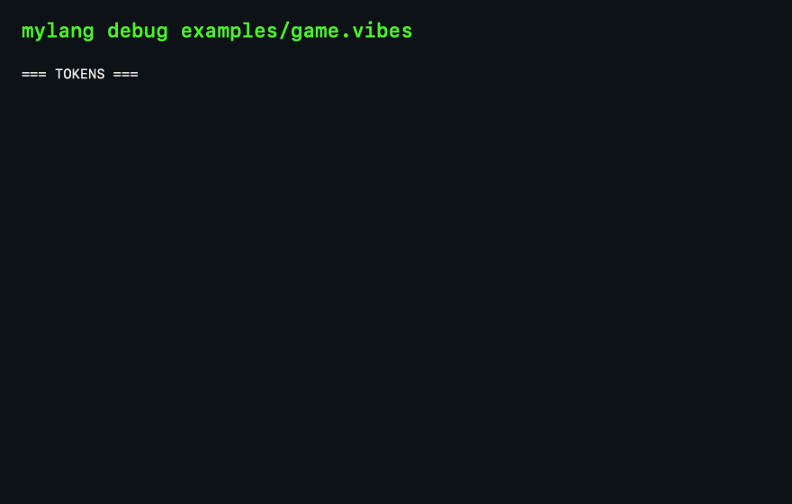

<div align="center">

# 🎮 MyLang — The Vibes Language

**A tiny, human-friendly language that transpiles to C99 + Raylib.**

Write games in `.vibes` and generate real C — or use it as a general-purpose
scripting language with functions, variables, arrays, dictionaries, and file I/O.

[](https://github.com/GitKamal17/mylang/actions/workflows/ci.yml)
[](LICENSE)
[](VERSION)



</div>

---

**New here? Start with [🚀 GETTING_STARTED.md](GETTING_STARTED.md)** — a 10-minute,
no-experience-required guide: how the compiler works, a tour of this repo, and
how to write your first programs and games.

**Two ways to learn:**
- **🕹️ [Game scripting path](#-quick-start)** — `window`, sprites, sound, collision, input: Pong, Breakout, Platformer
- **📖 [General-purpose path](#-general-purpose)** — `fn`, `print`, `if/else`, `while/for`, arrays, dictionaries, file I/O

Full documentation: **[LEARN.md](LEARN.md)** — the official language guide with
a step-by-step *teaching path* (lexer → parser → codegen) and a complete
keyword/builtin reference.

---

## ✨ What is MyLang?

MyLang is a **transpiler**: you write simple, readable `.vibes` files, and
`mylang` turns them into standard C99 that you can compile and run. No VM, no
interpreter loop — the output is real C.

**Two personalities in one tool:**

| Game scripting | General purpose |
|---|---|
| `window "Pong", 800, 600` | `fn add(a, b):`<br>&nbsp;&nbsp;&nbsp;&nbsp;`return a + b` |
| `circle x, y, 30, "red"` | `print "Hello, ", name` |
| `if key_right:`<br>&nbsp;&nbsp;&nbsp;&nbsp;`x = x + 5` | `if x > 10:`<br>&nbsp;&nbsp;&nbsp;&nbsp;`...`<br>`else:`<br>&nbsp;&nbsp;&nbsp;&nbsp;`...` |
| `sprite player = "player.png"` | `scores = {"alice": 95, "bob": 87}` |
| `play_sound("jump.wav")` | `write_file("out.txt", data)` |
| Collision detection, mouse, WASD | String methods, math, random, `sleep` |

## 🚀 Quick Start

### Prerequisites

| Tool | Why |
|---|---|
| `cc`/`clang` | C99 compiler for the generated code |
| `make` | Build convenience |
| [Raylib](https://www.raylib.com/) | Graphics library — only for game mode (`brew install raylib`) |

### Build & install

```bash
make                  # builds ./mylang (zero warnings)
make test             # runs all 110 tests (lexer, parser, codegen, indentation)
sudo make install     # installs to /usr/local/bin/mylang
```

### Your first program

```vibes
# examples/app.vibes
fn add(a, b):
    return a + b

name = input("Enter your name: ")
print "Welcome to MyLang, ", name

result = add(10, 20)
print result
```

Run it:

```bash
mylang run examples/app.vibes
```

### Your first game

```vibes
# examples/game.vibes
window "Movable Ball", 800, 600

x = 400
y = 300

if key_right:
    x = x + 5
if key_left:
    x = x - 5
if key_up:
    y = y - 5
if key_down:
    y = y + 5

circle x, y, 30, "red"
```

```bash
mylang run examples/game.vibes
```

An 800×600 window opens with a red ball you can move with the arrow keys.

## 🧰 CLI Reference

```
Usage: mylang <command> <file.vibes>

  check  <file>    Validate parsing/code generation without compiling
  emit   <file>    Parse and print generated C to stdout
  build  <file>    Parse, generate C, and compile to binary
  run    <file>    Parse, generate C, compile, and run
  debug  <file>    Print tokens and AST tree to stderr
  step   <file>    Step-through: tokens, then AST, then generated C
  visualize <file> Show the lexer → parser → codegen pipeline diagram
  --explain emit   <file>    Show annotated C code with source-line comments
  --explain tokens <file>    Show each token with plain-English explanations
  --version                  Print the mylang version and exit
  install <pkg>    Install a package (std, an HTTPS URL, or github:owner/repo/main/file.vibes)
  list             List installed packages (~/.mylang/packages)
```

**Tip:** a bare filename that isn't found in the current folder is looked up in
`examples/` automatically — so `mylang run breakout.vibes` works right from the
repo root.

## 🧪 Built-in standard library

**Math & random:** `sqrt`, `abs`, `sin`, `cos`, `tan`, `floor`, `ceil`,
`round`, `min`, `max`, `clamp`, `random`, `random_int`

**Type conversion:** `to_int`, `to_double`, `to_string`

**Time:** `sleep`, `time`

**Input & file I/O:** `input`, `read_file`, `write_file`, `append_file`,
`file_exists`

**Strings:** `.len`, `.split`, `.contains`, `.replace`, `.upper`, `.lower`,
`.trim`

**Game mode:** `window`, `sprite`, `draw_sprite`, `play_sound`, `play_music`,
`collide_circle`, `collide_rect`, `collide_point`, `mouse_x`, `mouse_y`,
`mouse_down`, `mouse_click`, and 10 key checks (arrows, WASD, space, enter)

> The complete reference — every keyword, built-in, and the 24 built-in colors —
> is in **[LEARN.md → Reference](LEARN.md#-reference--every-keyword--built-in)**.

## 🎮 Complete Example Games

| Example | File | What it shows |
|---|---|---|
| 🏓 **Pong** | [`examples/pong.vibes`](examples/pong.vibes) | 2-player paddles, ball physics, scoring |
| 🧱 **Breakout** | [`examples/breakout.vibes`](examples/breakout.vibes) | Bricks, bouncing, collision |
| 🏃 **Platformer** | [`examples/platformer.vibes`](examples/platformer.vibes) | Gravity, jumping, platforms |
| 🖼️ **Sprites** | [`examples/sprite.vibes`](examples/sprite.vibes) | Moving sprites with keyboard |
| 🔊 **Sound** | [`examples/sound.vibes`](examples/sound.vibes) | Audio loading & playback |
| 🖱️ **Mouse** | [`examples/mouse.vibes`](examples/mouse.vibes) | Mouse input & clicks |

## 📦 Package Manager

```bash
mylang install std                                  # install the bundled std package
mylang install https://example.com/math.vibes                  # from any HTTPS URL
mylang install https://example.com/math.vibes#sha256=<hex>     # pin + verify the SHA-256
mylang list                                             # show installed packages
```

> 🔒 **Security:** installed packages are code that gets compiled and run, so
> `mylang install` **refuses plaintext `http://` URLs**. For extra safety, pin
> a checksum with `#sha256=<64 hex chars>` — the download is verified against
> it before installation.

Then in your `.vibes` files:

```vibes
import "std/math"

# fn distance(x1, y1, x2, y2)  from std/math
d = distance(0, 0, 3, 4)
```

Imports are resolved relative to the current file, support nesting, and detect
circular imports. Duplicate function definitions are deduplicated in the
generated C.

## 🖥️ VS Code Extension

The extension provides **Run, Build, Check, generated C output, syntax highlighting,
and snippets**. Open this repository in VS Code, build the compiler with `make`,
and install the VSIX through **Extensions → … → Install from VSIX**.
Open `examples/hello.vibes` and click the play button.

To create the installable extension:

```bash
cd vibes-vscode
npm ci
npm test
npm run package
```

This creates `vibes-vscode-0.2.1.vsix`, which you can share directly.
See [the extension guide](vibes-vscode/README.md) for compiler configuration,
shortcuts, WSL setup, and development with F5. The compiler is installed separately.
Marketplace publication is not yet configured.

### Supported environments

- **macOS / Linux:** build with a C99 compiler and Make.
- **Windows:** use WSL and open the project in VS Code's WSL environment.
  The compiler currently relies on POSIX APIs; native Windows is unsupported.
- **Games:** require Raylib. Plain programs require only the C toolchain.

## 🛠️ Development

```bash
make            # build with zero warnings
make test       # run all test suites (lexer / parser / codegen)
make clean      # remove build artifacts
make demo-gif   # regenerate docs/demo.gif (requires swiftc, ffmpeg, python3)
```

See **[CONTRIBUTING.md](CONTRIBUTING.md)** for the full contributor guide.

## 📂 Project Layout

```
src/           lexer → parser → codegen + pipeline visualizer + CLI (main.c)
examples/      Ready-to-run .vibes programs
tests/         C test suites (test_lexer.c, test_parser.c, test_codegen.c, test_indent.c)
packages/      Source for bundled std packages
vibes-vscode/  VS Code commands, highlighting, snippets, and packaging
docs/          demo.gif — the animated showcase
LEARN.md       The official language documentation
GETTING_STARTED.md  The 10-minute beginner's guide (start here)
CHANGELOG.md   Version history
```

## 📄 License

[MIT](LICENSE) © 2026 MyLang contributors
